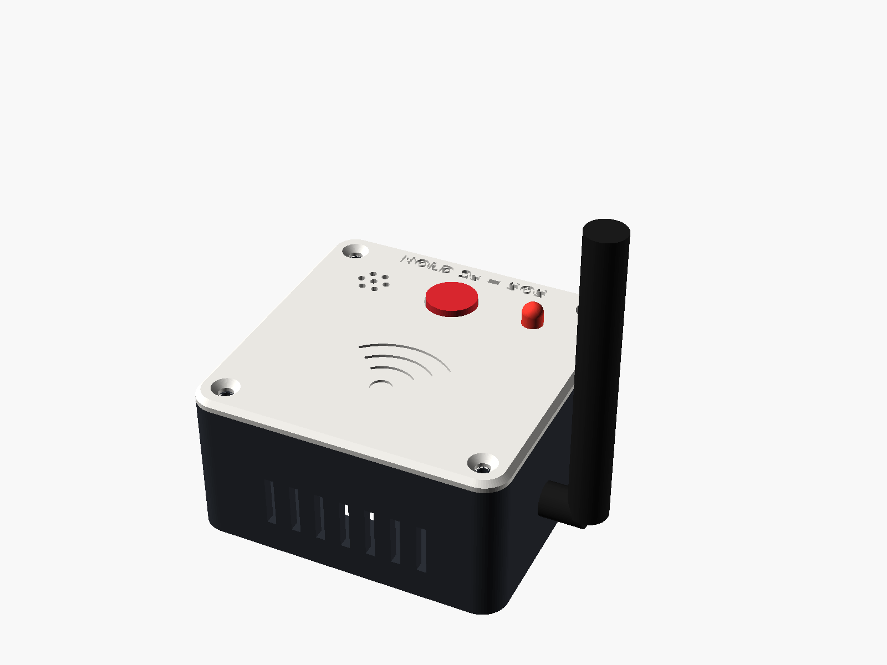
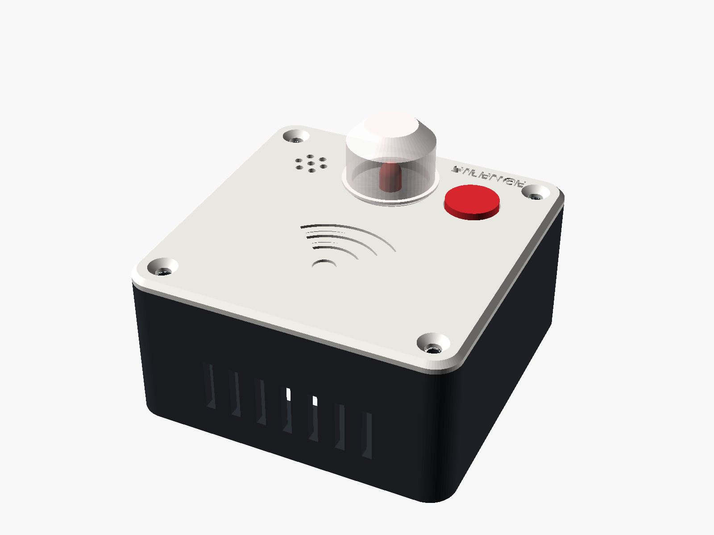
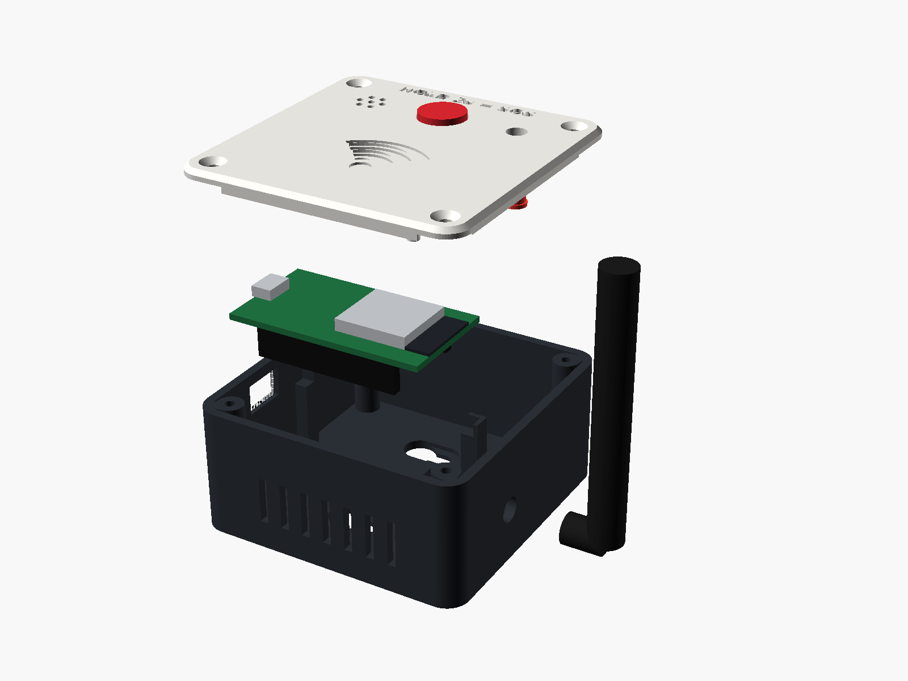
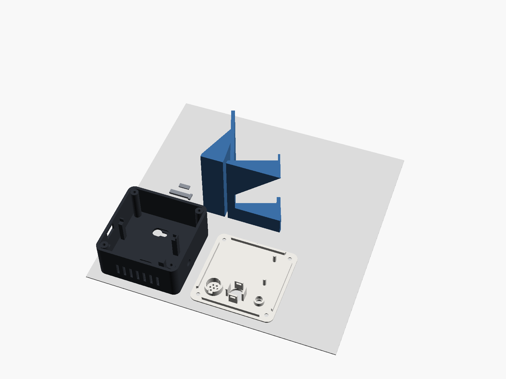
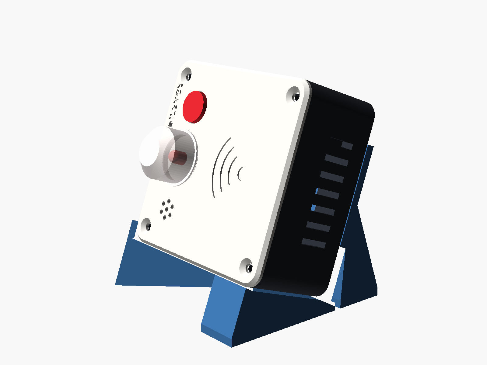

# Phase 8: Alert Station, SOS Button and 3D-Printed Enclosures

**Folder:** [`Phase8_Next_Phase/`](../Phase8_Next_Phase/) · **Status:** designed and tested in simulation, ready to flash and print · **Date:** 8 Nov 2026

> สรุปภาษาไทย: Phase 8 เพิ่ม (1) **Alert Station** กล่องแจ้งเตือนสำหรับผู้ดูแล (ESP32 + บัซเซอร์ + LED + ปุ่ม) ที่ดังพร้อมกันทุกเครื่องเมื่อตรวจพบการล้มหรือมีการกด SOS
> (2) **ปุ่ม SOS บน RX node**: ตอนว่างให้ **กดค้าง 2 วินาที** เพื่อขอความช่วยเหลือ ส่ง LINE แบบ SOS และทำให้ Alert Station ดังทันทีแม้ Raspberry Pi หรืออินเทอร์เน็ตล่ม
> (3) **กล่องพิมพ์ 3 มิติ** สำหรับ RX node และ Alert Station พร้อมขาตั้งโต๊ะ ไฟล์ .stl พร้อมพิมพ์ ไม่ต้องใช้ support




---

## 1. What is new

| | Before (Phase 5 / 7) | Phase 8 |
|---|---|---|
| Caregiver alarm | Phase 5 receiver: passive buzzer, plays 3 sweeps and stops | **Alert Station**: rings until someone silences it, different rhythm for fall and SOS, status light, self-test |
| SOS | Only via the old TX-node packet trick | **Hold the RX button 2 s** → LINE SOS card + every Alert Station rings |
| Works without the Pi? | No | **Yes for SOS**: the RX node broadcasts straight to the Alert Stations |
| Buzzer | Passive (PWM tones) | **Active** buzzer (on/off rhythms), polarity configurable |
| Boot without the Pi | RX node waited forever for the Pi's name | Keeps retrying in the background, button always works |
| Enclosure | none | Parametric OpenSCAD boxes, STL, PNG previews, desk stand, wall keyholes |

Everything older (Phase 1 to 7) is untouched. The Pi changes are small and backward compatible.

## 2. How the pieces talk

```
                         Wi-Fi LAN (UDP, no pairing, no IP addresses to type)
 ┌──────────────┐  CSI_DATA / HEARTBEAT  :5000   ┌───────────────────────┐   LINE push
 │  RX node     │ ─────────────────────────────▶ │ Raspberry Pi 5         │ ─────────────▶ caregiver phone
 │ ESP32+antenna│  SOS_ALERT,<room>       :5000  │ headless_brain.py      │
 │ buzzer LED   │ ─────────────────────────────▶ │  fall model + SOS      │
 │ SOS button   │                                └──────────┬────────────┘
 └──────┬───────┘                                           │ broadcast 255.255.255.255:5005
        │ SOS_ALERT:<room>  broadcast :5005                 │ FALL_ALERT:<room> / SOS_ALERT:<room> / FALL_SILENCE
        ▼                                                   ▼
 ┌─────────────────────────────────────────────────────────────────┐
 │ Alert Station(s) - as many as you like, all ring together       │
 │ heartbeat ALARM_READY:<ip> → Pi :5002 every 5 s                  │
 └─────────────────────────────────────────────────────────────────┘
```

| Message | From → To | Port | Meaning |
|---|---|---|---|
| `CSI_DATA,<room>,...` | RX → Pi | 5000 | Wi-Fi CSI frame (unchanged) |
| `HEARTBEAT` | RX → Pi | 5000 | RX alive (unchanged) |
| `SOS_ALERT,<room>` | RX → Pi (unicast, or broadcast if the Pi was not found) | 5000 | SOS button held 2 s; sent 3× 250 ms apart |
| `SOS_ALERT:<room>` | RX → all (broadcast) and Pi → all | 5005 | Alert Stations play the SOS rhythm |
| `FALL_ALERT:<room>` | Pi → all | 5005 | Fall detected, fall rhythm (RX nodes ring too, as in Phase 7) |
| `FALL_SILENCE` | Pi → all | 5005 | Silence button in LINE / dashboard `/silence` |
| `ALARM_READY:<ip>` | RX / Station → Pi | 5002 | Alarm device alive |

**Why UDP broadcast and not ESP-NOW or MQTT?** The Pi already broadcasts on 5005 and the Phase 5/7 devices already listen there, so nothing new has to run on the Pi, and a new station works as soon as it joins the Wi-Fi. ESP-NOW would need a fixed Wi-Fi channel shared with the router (the CSI node is already in STA + promiscuous mode), and MQTT would add a broker that can fail. Duplicate packets are handled: the Pi counts SOS copies within 15 s as one, and a station ignores copies of an alert it just silenced for 8 s.

## 3. Button behaviour

### RX node (GPIO 17)

| When | Action | What happens |
|---|---|---|
| Idle | **Hold 2 s** | LED lights while you hold, then 3 chirps = SOS sent. The node keeps sounding the SOS rhythm so people nearby hear it |
| Idle | Short press | Status: 1 chirp = Wi-Fi OK, LED flashes 3× with no sound = no Wi-Fi |
| Ringing (fall or SOS) | Any press | Silences **this** node at once. Holding on does **not** send an SOS |

### Alert Station (GPIO 17)

| When | Action | What happens |
|---|---|---|
| Ringing | Any press | Silences this station (other stations keep ringing until silenced, or until LINE "Silence" is pressed) |
| Idle | Hold 2 s | Self-test: 1 s beep, and an immediate heartbeat to the Pi |
| Idle | Short press | Status chirp, same as the RX node |

Idle status light: a tiny blink every 3 s = connected; a double blink every second = no Wi-Fi.

### Sounds (active buzzer rhythms)

| Pattern | Rhythm | Used for |
|---|---|---|
| Fall | 150 ms on / 100 ms off, repeating | Fall alarm |
| SOS | Morse `··· ––– ···`, repeating | SOS alarm |
| Confirm | 3 quick chirps | SOS was sent |
| Boot | 2 short beeps | Connected to Wi-Fi |
| Test | 1 s beep | Station self-test |

An SOS outranks a fall: if a station is ringing for a fall and an SOS arrives, it switches to the SOS rhythm.

## 4. Pi changes (`Phase4_Multi_Node/`)

- `line_notifier.py`: new `send_sos_alert()`, a separate LINE card ("🆘 SOS BUTTON PRESSED / HELP REQUESTED IN ...") with the same *Call 1669* and *Silence* buttons. The fall card is unchanged.
- `alarm_broadcaster.py`: new `send_sos_broadcast()` (`SOS_ALERT:<room>`), shared send code, socket always closed.
- `headless_brain.py`: SOS has its **own** 15 s dedupe timer. Before, an SOS used the fall alert's 60 s cooldown, so an SOS could silently block a real fall alert for a minute (and vice versa). The dashboard card shows **SOS PRESSED!** / **ขอความช่วยเหลือ (SOS)!** for 30 s.
- `udp_reader.py` / `serial_reader.py`: one `parse_sos_line()` accepts `SOS_ALERT,<room>` and `SOS_ALERT:<room>` over Wi-Fi and USB.
- Tests: 11 new tests in `Phase4_Multi_Node/tests/test_brain.py` (35 total, all pass).

No config change is needed. `alarm.udp_port` (default 5005) and `alarm.enabled` in `config.json` apply to SOS too.

## 5. Hardware

Both devices use the same parts and the **same pins**, so the same wiring works for either.

| Part | Qty per device | Notes |
|---|---|---|
| ESP32 DevKit (30/32-pin, micro-USB) | 1 | Measure the PCB (see section 7) |
| Active buzzer 12 mm (5 V or 3.3 V) | 1 | Peel off the sealing sticker if it has one |
| Red LED 5 mm | 1 | |
| Resistor **220 Ω** | 1 | For the LED |
| Tactile switch 12 × 12 mm + round cap | 1 | |
| 2.4 GHz antenna + SMA-to-IPEX pigtail | RX node | Your boards are ESP32-WROOM-32U (IPEX socket): the RX uses the big external antenna |
| Small IPEX stick/flex antenna | Alert Station | A WROOM-32U has **no antenna on the module**, so keep its small antenna clicked on inside the box |
| NPN transistor S8050 / 2N2222 + 1 kΩ | optional | Louder buzzer (recommended for the demo hall) |
| M3 × 10 countersunk screws | 4 | Self-tapping, or M3 machine screws (they cut their own thread in the 2.5 mm pilot) |
| 8 mm stick-on rubber feet | 4 | optional |

### Wiring

```
ESP32 DevKit                        Parts
────────────                        ─────
GPIO 2  ──[220 Ω]──▶|── GND         Red LED: long leg (+) to the resistor, short leg (–) to GND
GPIO 4  ─────────── (+) BUZZER (–) ── GND
GPIO 17 ───── BUTTON ───── GND      use two DIAGONAL legs of the 12x12 switch
3V3 / GND                           (nothing else needed: the button uses the internal pull-up)
```

**LED resistor:** 220 Ω gives about (3.3 V − 2.0 V) / 220 Ω ≈ 6 mA: clearly bright and safe for the pin. Use 150 Ω (~9 mA) if you want it brighter under the Alert Station dome. Do not go below 100 Ω.

**Louder buzzer (recommended):** a bare active buzzer on a 3.3 V pin is quieter than at 5 V. Drive it from 5 V with an NPN transistor (S8050 / 2N2222 from the kit):

```
GPIO 4 ──[1 kΩ]── B   (NPN)
                  E ── GND
                  C ── (–) BUZZER (+) ── VIN / 5V (USB 5 V)
```

This is still "HIGH = beep", so no firmware change. If you use a 3-pin **buzzer module** instead (VCC / GND / I/O) and it beeps when it should be quiet, it is a "low-level trigger" module: set `#define BUZZER_ACTIVE_HIGH 0` at the top of the sketch.

**GPIO notes:** GPIO 2 is also the on-board blue LED and a boot strapping pin. An LED + resistor to GND keeps it low at boot, which is what the ESP32 wants, so uploads still work. GPIO 17 is free on WROOM boards (do not use it on WROVER boards with PSRAM).

**Antenna:** your boards are **ESP32-WROOM-32U** (metal can with a tiny round IPEX socket, no zig-zag antenna on the module). A 32U board has **no Wi-Fi at all without an antenna**, so every device needs one clicked on:

- **RX node:** the 2.4 GHz SMA antenna through the hole in the base. CSI quality depends on it.
- **Alert Station:** it only receives a short UDP message, so it does **not** need the big outside antenna. Keep the small IPEX antenna that came with the board (stick or flex type) clicked on and lay it flat inside the box, away from the USB cable. The plastic does not block Wi-Fi. If you would rather use an outside SMA antenna anyway (for example a station far from the router), print `alert_station_base_antenna_hole.stl` instead of `alert_station_base.stl`.
- A board with the zig-zag PCB antenna (WROOM-32, no U) needs no antenna at all: use the Alert Station base for either device.

**Power:** micro-USB. For demo day from a power bank, pick one without auto-off, or switch on its "low current" / "small device" mode: an ESP32 draws ~80 to 150 mA and some banks turn off below ~100 mA.

## 6. Firmware

| Sketch | For |
|---|---|
| [`Phase8_RX_Node/Phase8_RX_Node.ino`](../Phase8_Next_Phase/Phase8_RX_Node/Phase8_RX_Node.ino) | The CSI sensor node (replaces Phase 7 on the RX ESP32) |
| [`Phase8_Alert_Station/Phase8_Alert_Station.ino`](../Phase8_Next_Phase/Phase8_Alert_Station/Phase8_Alert_Station.ino) | Each caregiver Alert Station |
| `sentry_common.h` (same file in both folders) | Button debounce / long press, buzzer rhythms, message parsing, repeat filter. No hardware calls, unit-tested on a PC |

Upload (Arduino IDE 2, **ESP32 board package 3.x by Espressif**, board "ESP32 Dev Module"):

1. In the sketch folder, copy `secrets.example.h` to `secrets.h` and put your Wi-Fi name and password in it. `secrets.h` is git-ignored: never commit it.
2. RX node only: set `node_location` (e.g. `"Bath Room"`) and check `dest_host` is your Pi's hostname.
3. Alert Station only: optionally set `station_name` (Serial log only).
4. Upload. Serial Monitor: RX node 460800 baud, Alert Station 115200 baud.

## 7. 3D enclosures



| File (`Phase8_Next_Phase/enclosures/stl/`) | Print | Colour idea |
|---|---|---|
| `rx_node_base.stl` | 1 | dark grey / black |
| `rx_node_lid.stl` | 1 | white |
| `alert_station_base.stl` | 1 per station | dark grey / black |
| `alert_station_base_antenna_hole.stl` | instead of the one above, only if you want an outside antenna on the station | dark grey / black |
| `alert_station_lid.stl` | 1 per station | white |
| `alert_station_light_dome.stl` | 1 per station | **natural / translucent white** PLA or PETG (it diffuses the LED) |
| `button_backer_bar.stl` | 1 per device | any |
| `button_shim_1mm.stl` | only if needed (see assembly) | any |
| `desk_stand.stl` | optional, fits both devices | any |

Size of each device: **72.8 × 72.8 × 35.8 mm**. Every part fits a 220 × 220 mm bed (both sets fit on one bed).

**Print settings for the shop:** PLA or PETG, 0.4 mm nozzle, 0.2 mm layers, 3 walls, 20 % infill, **no supports**. The STLs are already in print orientation (base open side up, lid top face down so the engraved text comes out crisp, stand on its side). Optional 5 mm brim on the stand.



### Design features

- **Same footprint for both devices**: one stand, one screw set, one print profile.
- **PCB cradle**: 4 corner posts (kept 3.5 mm from the PCB ends so they miss the header pins), side fences that locate the board, and two lid pillars that stop it lifting (0.4 mm gap). 21 mm under the PCB for the header pins plus Dupont jumper housings with room to bend the wires.
- **USB opening** lined up with the board's micro-USB, chamfered so bulky cables fit.
- **SMA antenna hole** (RX) at the far end from the USB, at the same end as the ESP32's antenna.
- **Lid**: chamfered edge, engraved Wi-Fi wave mark (no brand name, so you can call the product anything) and labels ("HOLD 2s = SOS" / "SILENCE"), buzzer sound grille, LED seat (the LED rim stops on the lid underside), button socket, buzzer ring with 3 crush ribs (holds without glue), skirt that keys the lid into the base.
- **Button socket + backer bar**: the 12 × 12 switch sits in an open-corner socket (legs come out at the corners) and a printed bar slides through two slots underneath it, so pressing the button pushes against plastic, not glue.
- **Light dome** (Alert Station): press-fits into a recess around the LED, 45° top and 45° flange so it prints without supports.
- **Mounting, your choice:** flat on a table (rubber-foot recesses), **wall** (two keyhole slots, 32 mm apart, for screws with a ≤ 4 mm shank and ≤ 8 mm head; hang it USB end down), **desk stand** (20° tilt, cable notch for the USB plug), or double-sided tape on the flat bottom.
- Side vents. No name is printed anywhere on the parts.



### Before you order: measure your ESP32

The box is parametric. Open `enclosures/scad/sentry_enclosure.scad` and check the block **MEASURE YOUR PARTS**:

| Parameter | Default | Change if |
|---|---|---|
| `board_l` × `board_w` | 52.0 × 28.5 mm | your PCB is different (38-pin boards are ~55 × 28) |
| `btn_stack_h` | 10.3 mm | your switch + cap is taller/shorter (switch bottom to cap top) |
| `buzzer_d` | 12.0 mm | different buzzer |
| `sma_d` | 6.6 mm | different antenna connector |

Then run `bash Phase8_Next_Phase/enclosures/build.sh` (needs OpenSCAD, plus `pip install trimesh manifold3d` for the checks). It re-exports every STL and PNG and re-runs the checks. Free OpenSCAD: <https://openscad.org>.

### Assembly

1. **Lid:** push the LED in from below until its rim stops (long leg towards the resistor wire). Press the buzzer into its ring (sound side up against the grille). Put the cap on the switch, drop the switch into its socket from below with the cap through the hole, and slide the backer bar through the two slots under it. If the cap does not stick out enough, add the 1 mm shim between bar and switch.
2. Solder or plug the wires (section 5).
3. **Base:** if you use the antenna, mount the SMA bulkhead in its hole and click the IPEX end onto the module (press straight down, the connector is fragile). Lay the ESP32 pins-down on the 4 posts with the USB socket at the USB opening.
4. Close the lid (it only fits one way: the skirt keys it) and drive the 4 M3 screws.
5. Optional: rubber feet, or hang it on two wall screws, or put it on the stand.

## 8. How it was checked

Run these yourself from the repo root:

```bash
python -m pytest Phase4_Multi_Node/tests -q                 # Pi: 35 passed
bash Phase8_Next_Phase/firmware_tests/run_tests.sh           # firmware logic: all pass
python3 Phase8_Next_Phase/enclosures/check_stl.py            # STLs: ALL STL CHECKS PASSED
```

- **Pi** (35 tests): SOS copies count as one alert, a new SOS after 15 s alerts again, an SOS does not block a following fall alert, both SOS formats parse, a real UDP SOS packet reaches the brain, broadcast message formats, SOS LINE card text.
- **Firmware** (31 tests, compiled with `-Wall -Wextra -Werror` on g++ and clang++): the real `.ino` files run on a PC against a small Arduino/ESP32 stand-in (`firmware_tests/mock/`) with simulated time, pins and UDP. Covered: 2 s hold sends 3 SOS copies to the Pi and the stations, short press does not, press silences at once and the rest of that press is ignored, SOS falls back to broadcast when the Pi is not found, fall alarm rings until remote silence, CSI frames still go out, heartbeats, boot without Wi-Fi does not hang, debounce, `millis()` wrap-around, Morse SOS timing, station ignores repeats of a silenced alert but not a new room, SOS outranks fall, idle status light.
- **STLs:** every part is closed and manifold (trimesh + manifold3d), one solid body, sits on the bed, fits 220 mm, and has no ceiling wider than 7.5 mm (so no supports). A fit check places the lid, PCB, buzzer, switch, cap, backer bar and LED where they really go and finds **no collisions**, confirms the PCB rests on its posts and cannot lift more than 0.6 mm, the lid sits on the walls, the buzzer is gripped by the crush ribs, and the cap sticks out 1.5 mm.

**Not checked here:** the sketches were not compiled with the real ESP32 toolchain, because this cloud machine could not download it. They only use APIs that the Phase 7 sketch already uses, plus `WiFi.setAutoReconnect`, `WiFi.setSleep` and `MDNS.queryHost(host, timeout)`, all standard in ESP32 core 3.x. Compile once in the Arduino IDE before demo day. Nothing has been printed yet: print one lid first and check the button and LED fit before printing the rest.

## 9. Demo-day checklist

1. Power the Pi, then the Alert Station(s), then the RX node. Each beeps twice when on Wi-Fi.
2. Alert Station: short press → 1 chirp (Wi-Fi OK). Hold 2 s → 1 s test beep.
3. RX node: **hold 2 s** → 3 chirps, the station plays SOS in Morse, the LINE SOS card arrives, the dashboard card says **SOS PRESSED!**
4. Press the station button → it stops. Press the RX button → it stops.
5. Do a fall (or the dashboard's debug fall) → fall rhythm on every station + LINE fall card. Press **Silence** in LINE → all stop.
6. Unplug the Pi and hold the RX button again → the stations still ring (direct broadcast). That is a good point to show the judges.
